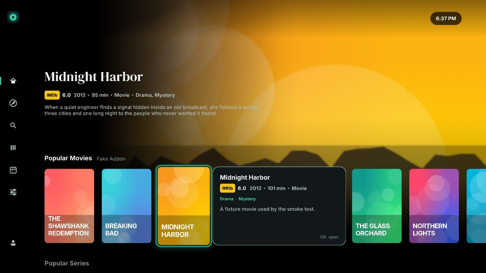
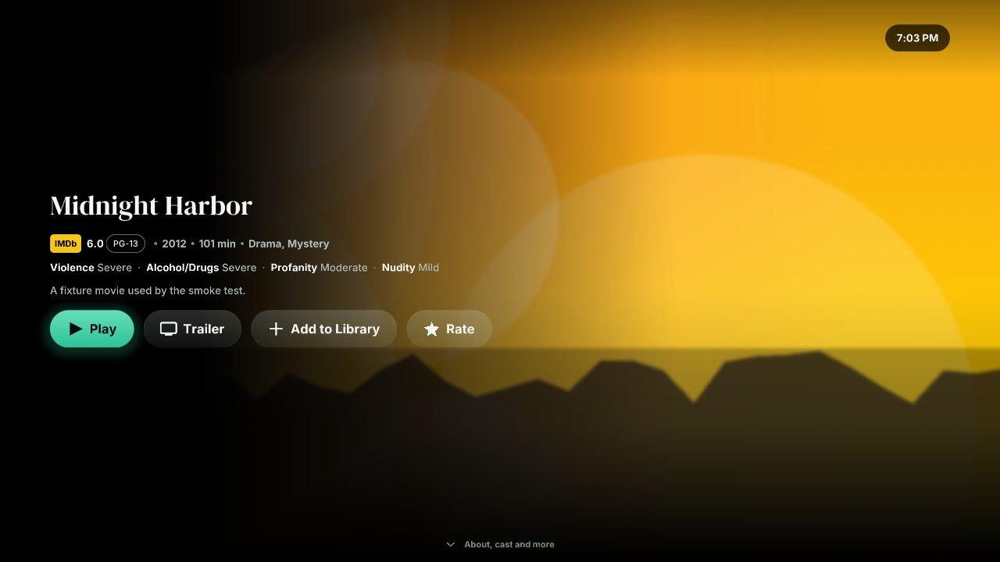
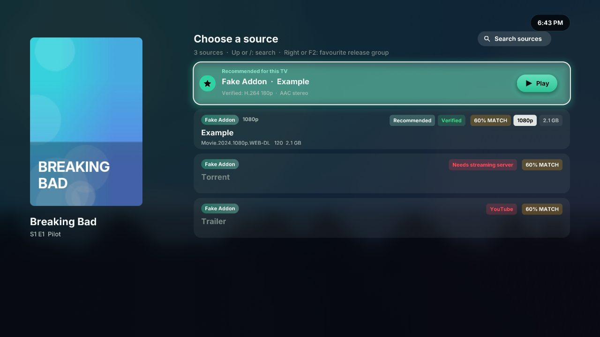
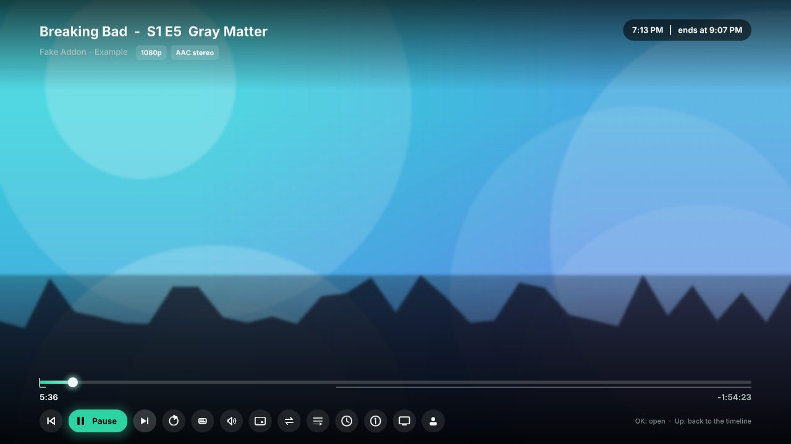
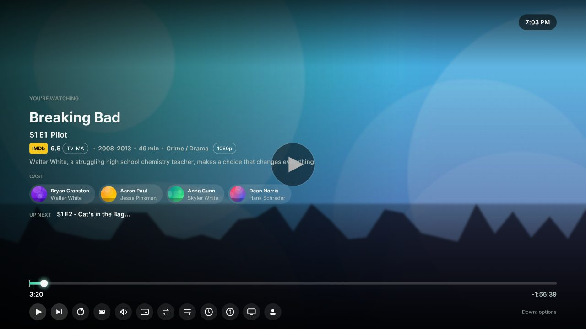
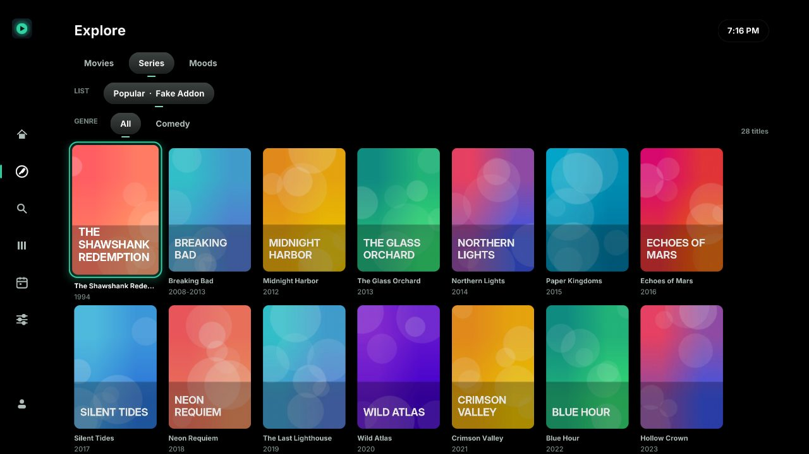
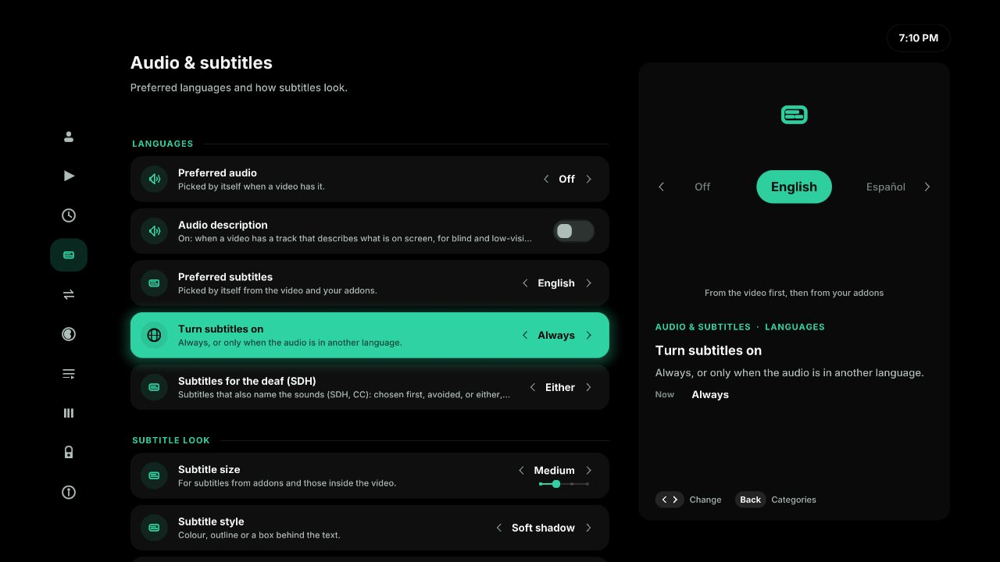
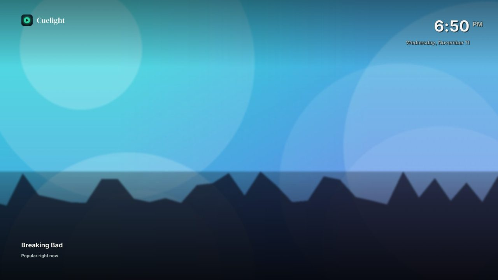
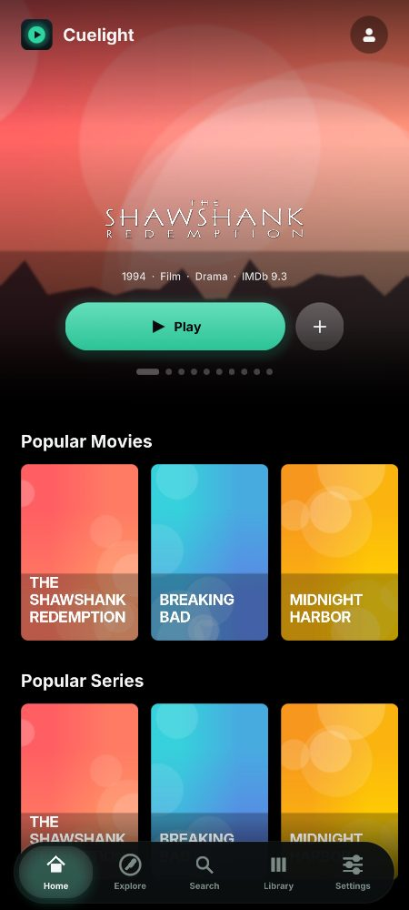
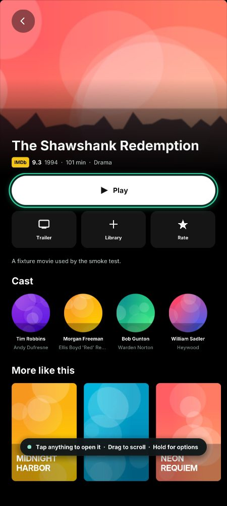

# Cuelight (beta)

> **Beta:** Cuelight is in active development. Expect rough edges; the Windows app is a
> preview. Settings > About > Diagnostics in the app shows a log to report a problem with.

*Your cue to press play.* Cuelight is a fast native player that works with your Stremio
account and addons: the same sign-in, addons, Library and Continue Watching. It runs on
LG webOS TVs (webOS 3.0 and newer), on Android phones, tablets, Android TV, Google TV
and Fire TV (Android 7 and newer), and as a preview on Windows 10 and 11.

> Cuelight is an independent project. It is not affiliated with, endorsed by or made by
> Stremio, LG, Google or YouTube. It plays only what your own addons and accounts provide.

This repository holds the builds. The newest is **v0.10.131**: see
[Releases](https://github.com/smalik29871/cuelight-releases/releases) for what changed in each version.

**Contents:** [A look](#a-look) · [What it does](#what-it-does) · [Settings](#settings-at-a-glance) ·
[Player keys](#player-keys) · [Torrents, servers and previews](#torrents-servers-and-previews) ·
[Reporting a problem](#diagnostics-reporting-a-problem) · [What is verified](#what-is-verified-and-what-is-not) ·
[Install](#install-on-an-lg-tv) · [Updates and the beta](#updates-and-the-beta) ·
[What it sends where](#what-cuelight-sends-where) · [Licence](#licence)

## A look

Taken from the app against a test addon, so the artwork is generated and the titles are
stand-ins. The look is **Cue**, the default; eight more are in Settings > Interface > Theme.

| | |
|---|---|
|  **Home**: the focused title becomes the backdrop, details beside the poster |  **Title page**: rating, age rating, what a parent should know |
|  **Sources**: the one to play, checked first |  **Player controls** |
|  **Paused**: what you are watching, the cast, what is next |  **Explore**: catalogs, genres and moods |
|  **Settings**, each with a live preview |  **Screensaver**: artwork and the time |

On a phone:

| | |
|---|---|
|  |  |

## What it does

### Look
- **Nine themes**, switched in Settings > Interface, most with accent colours (or the
  artwork's own) and backgrounds: **Cue** (the default since 0.10.126: the logo's mint
  light on an OLED-black stage, the wordmark's serif for titles, a soft mint halo for
  focus and buttons gently lit from above), **Streaming** (familiar and calm),
  **Aperture** (charcoal and ivory, editorial: artwork windows, coral focus markers, pause
  title cards, a seek filmstrip), **Mist** (cool and soft), **Sunset** (warm dusk tones),
  **Signal** (graphite, lime, sharp corners, a solid accent frame for focus, capital
  titles, mono metadata, numbered rows), **Marquee** (warm ink and parchment, amber,
  condensed display titles, a light bar under the focused card), **Glass** (frosted
  panels over the artwork, a white focus glow) and **Metro** (flat colour tiles, big light
  lowercase headings, a white tile border for focus). Glass blurs by sampling a small mip
  of artwork already loaded, so it costs one textured quad.
- **Clock island**: the clock in the corner grows into notices, progress and a *Resume*
  card for the title you just left (Blue opens it), then shrinks back to the time.
- **Motion**: titles open out of the card you chose and shrink back into it on Back;
  rows scroll on a spring; cards dip on OK, nudge at the end of a row and rise in one
  after another when a row arrives. All of it is clipping, scale and fade per vertex:
  no offscreen buffers, and Light effects turns it off.
- **Settings with previews**: rows grouped under headings with a line of help each, and
  beside them a drawing of what the focused setting changes, redrawn as you change it.
- **Details on focus**: rest on a poster and a panel slides open beside it with the
  rating, year, runtime, genres, synopsis and your Library state (can be turned off).

### Browse
- **Side rail** (press Left): Home, Explore, Search, Library, Calendar, Settings, account.
- **Three Home styles**: Cinematic (the focused title becomes the backdrop), Showcase
  (featured carousel) and Compact (rows from the top). Rows can be reordered and hidden,
  watched titles can be hidden, and the addon order syncs with the account.
- **Explore** any catalog by type, list and genre with an endless grid; **Library** with
  filters and sort; **Calendar** of upcoming and recent episodes of the series you follow.
- **Search** across every catalog addon that supports it, debounced as you type. The
  keyboard opens when you press OK on the search bar, with a QR code to type on your phone.
- **Title pages** with logo, IMDb rating, genres, synopsis, cast (photos from the meta
  addon or TMDB), age rating, resume with progress, seasons and episode thumbnails, and
  spoiler blur on episodes you have not seen.
- **Cache-first**: Home opens instantly from the last visit while rows refresh.

### Play
- **The TV's own decoder** (`com.webos.media`), with the video plane resized live for
  **picture-in-picture** (off by default; Settings > Playback) and **aspect ratio** (Fit,
  Fill, Zoom).
- **Control bar**: Previous/Next episode, Play/Pause, Reload, Subtitles, Audio and speed
  (0.5x to 2x), Aspect, Sources, Episodes by season, Stats. Paused for a moment, the
  player shows the synopsis and cast of what is playing.
- **Sources** from every stream addon, scored by name (resolution, codec, HDR/DV, audio,
  size, seeders, cached) against a profile of this TV that learns from what played and
  what failed. The first 2 MB of the best candidates are fetched and their container
  header read, so the recommendation says what was verified ("HEVC 2160p, DD+ 5.1,
  chapters") and dead links or files faster than your line are dropped.
- **Automatic fallback** to the next source when playback fails or stalls; **Up Next**
  with autoplay, fetched while the credits roll; **chapters** on the timeline from the
  file header; -10 s / +10 s feedback while seeking; **seek previews** decoded
  on the TV (below).
- **Skip intro / recap** and credits-based Up Next from TheIntroDB and AniSkip (free,
  keyless): a button, automatic, or off.
- **Track memory**: audio and subtitle choices are remembered per series; subtitles can
  turn on only when the audio is in another language; forced subtitles in the audio's
  language are picked from the file header.
- **Stats for nerds** (Red): codec, resolution, fps, bitrate, buffer, stalls, file hash.
- **Living letterbox** (experimental, Settings > Playback): a film wider or narrower than
  the screen lights its black bars with its own colours. **Soft light**, the lightest for a
  TV, takes the colours at the picture's edges from a small frame every few seconds (or
  the colours other viewers' devices shared, with no frame at all) and fades them in
  slowly; **Glow** and **One colour** follow every cut.
- **Screensaver** with drifting backdrops and a clock after a quiet spell, OLED-safe. The
  fireplace style plays your own fireplace video, or a free one under an open licence
  (streamed, never kept), or draws its own fire when offline.

### When YouTube refuses
YouTube sometimes asks a device to prove it is no bot before it gives a video to a
third-party player. When it refuses a trailer, an addon's YouTube video or the fireplace
video:
- **On Android** the video plays in YouTube's own embedded player
  ([android-youtube-player](https://github.com/PierfrancescoSoffritti/android-youtube-player)),
  inside Cuelight's player screen with the same controls.
- **Elsewhere** (an LG, a computer) Cuelight offers the device's YouTube app where there is one.
  The fireplace plays the copy saved for breaks, then the free fireplace video, then the
  drawn fire.

### Subtitles
- Addon subtitles (SRT, VTT) drawn by the app with four **styles**, four sizes and three
  positions, changed live from the player's Subtitles menu or Settings; embedded tracks
  drawn by the TV.
- **Every file per language** is listed, grouped by addon, with a **second subtitle
  language** drawn above the first for learners.
- **Matched to the file**: the player fingerprints the video the way OpenSubtitles does
  (size plus the first and last 64 KB) and asks the addons for files made for that exact
  release. They come first, marked *matched to this file*.
- **Auto-sync**: pick any other file and its cue timings are compared with a matched one;
  the offset is applied by itself ("Subtitles synced to the file, +1.3 s"). Manual
  timing in 0.1 s steps sits at the top of the Subtitles menu.
- **Synced to the film itself** when no file was matched: to the film's own text track
  while it plays, or (on a PC) to the speech in its sound. A fix that does not really
  line the subtitles up is not applied. **Sync to this line**: OK on Subtitle timing shows
  the next line; press OK when it is spoken. A timing one device found is used at once by
  the next viewer of the same file and subtitles (only the times are shared).
- **The film's own subtitles first**: when the TV lists them a few seconds after the
  sound, Cuelight waits for them rather than settling on an addon's file, and on an LG it
  draws lines the TV would show with their font tags as text.
- **Translate** (with the AI assistant, below) when nobody offers your language: the
  English file is translated in batches around the playhead, so it starts in seconds and
  keeps going as you watch.

### AI assistant (optional, your own free key)
Settings > Accounts > **AI assistant** takes a key from **Groq**, **OpenRouter** or
**Google Gemini** (all have free tiers; the screen says where to get one), or any
OpenAI-compatible endpoint such as an **Ollama** box on your network (no key). Nothing is
sent anywhere until you turn it on. It adds:
- **Ask AI** on a title page: what it is in a nutshell, who will enjoy it, what a parent
  or sensitive viewer should know, three similar titles. Spoiler-free, cached for a month.
- **Describe what you want** in Search ("something funny with robots"): the model names
  titles, your addons find them, and they are listed first with a star.
- **Subtitle translation** into your preferred language, as above.

### Take breaks
Settings > **Take breaks** schedules pauses: **prayer times** computed on the TV from
your location (MWL, ISNA, Egypt, Umm al-Qura, Karachi, Tehran, Jafari methods, Hanafi
Asr; Angelus, Nitnem, Sandhya, zmanim and Baha'i windows as well), **stretch** reminders,
**bedtime**, or **your own times**. A banner warns a few minutes ahead, then the video
pauses on a calm page with a chime or your own recording (an adhan, a dua, a bell: sent
from your phone to the TV, a direct link, or a YouTube link the TV saves once and then
plays offline, shown full screen if it is a video), and playback continues where it stopped. Research and sources are in `docs/BREAKS.md`.

### Everyday conveniences
- **Hold OK** (or press Yellow, Menu or Info) on any title: mark watched or not watched,
  remove from Continue Watching, add to or remove from the Library.
- **From the start** next to Resume, **recent searches**, a **No internet** pill, a notice
  after a crash, and a note when a newer version is in the Homebrew Channel.
- **Sources** in your audio language first, a cap on how long autoplay waits for slow
  addons, failed links sorted last for six hours, and addon notice rows never autoplayed.

### Keys, phones and safety
- **Type it on your phone**: every text field shows a QR code; the TV serves a small page
  on your network where you paste the key, URL or password, and it lands in the field.
- **Accounts** (one place for every account and key): TMDB (the built-in catalog, cast photos and age ratings; a key baked into CI builds from the
  `TMDB_API_KEY` repository secret is used when you have none), Stremio sync, Trakt, SimKL,
  TorBox, OpenSubtitles, MDBList and the AI assistant.
- **Saved sign-ins** you can switch between, and a **parental PIN** that can guard
  Settings and adult addons.
- **Sign in by QR** or short code via link.stremio.com; e-mail and password as fallback.
- **Stremio sync that keeps up**: progress, Continue Watching and watched episodes go both
  ways with the Stremio apps, in Stremio's own format (nothing Stremio keeps for a title is
  lost). The account is asked what changed every 2 minutes, after playing and back on
  screen, and only those titles come over; a change the account did not take is sent again.
  Each profile's watched episodes are its own.
- **Mute bad language** (Settings > Parental): the sound goes quiet for each swear word
  found in the English subtitles, shown or not, and the word is starred out on screen.
- **Scene filter**: scenes from CleanStream's lists are skipped, or offered with a *Skip
  scene* button; lists timed on another release are lined up with your copy by the words
  both have. Any scene can be marked from Scenes (start, end, what is in it), and shared
  with CleanStream only if you choose. **Spot nudity** (experimental, off by default): a
  small model on the device looks at the frames a little ahead and offers *Skip scene?*;
  the pictures never leave the device.

### Built for old TVs
- Idle frame skipping, a batched GLES2 renderer (one draw call for most screens), disk
  caches for artwork and catalogs, poster prefetch, eased scrolling and cross-fades.
- **Nothing heavy in a frame**: catalog and source replies are parsed and cached on the
  network threads, handed to the screen within an 8 ms budget per frame, and anything
  slower is logged with its host. Idle, the app wakes the instant a key arrives.
- An **Automatic effects level** measures the TV and drops to Light when it cannot keep up.
- A **memory saver** that watches the TV: on a small set (about 1 GB) it is on from the
  start; on any set it turns itself on when free memory gets tight (fewer rows and
  posters kept, artwork budget cut, posters decoded at half size), and off again once
  there is room. Before that it steps down in stages: as memory gets low, poster
  prefetch, trailers and seek strips pause and the P2P cache halves; when it is tight,
  the saver comes on, effects go light, the screensaver falls back to the plain clock
  and the script sandbox shrinks; each comes back by itself after a minute or two of
  room. Behind the TV's Home the artwork is let go. While a video fills the screen on
  such a TV the artwork cache shrinks further so the decoder has room, and freed memory
  is handed back to the system. It also answers the system's low-memory warning (and
  Android's trim levels, where the player's buffers are sized by the stage too).
  Settings > Interface shows why it is on; Diagnostics shows the stage.
- **Shared connections**: the network workers share DNS answers and TLS sessions, so a
  server one of them has reached is resumed by the others without a full handshake.
- **libcurl via `dlopen`**, because LG ships `libcurl.so.5` and the SDK ships `.so.4`.
- **Diagnostics** on the TV itself: the app's log by tab, the previous session's log
  after a crash, and a QR code that carries the lines to your phone.
- **A data folder that stays small** (`src/tidy.c`): reply caches by age and size,
  unused recordings, crash leftovers and old font atlases are cleared on a background
  thread after start; the artwork cache trims itself at 96 MB; the log restarts at 4 MB.

### Where ideas came from
Stremio-Kai: per-series track memory, "subtitles only for other languages", the player
clock and end time, the first-run setup, the OLED theme. The Nuvio port
([nuvio-native-legacy](https://github.com/iqui27/nuvio-native-legacy)) and NuvioMobile:
cache-first Home, Automatic/Full/Light effects, spoiler blur, QR sign-in, skip intro and
credits Up Next, the exported-window / ACB split, dlopen'd curl, the log file, the phone
layout. [youtube-webos](https://github.com/webosbrew/youtube-webos): running YouTube's TV
client as an LG web app. These are designs followed, not code: those projects are GPL 3.0
and nothing of theirs is copied here (see THIRD-PARTY-NOTICES.md).
Left out on purpose for stability: FFmpeg transcoding, libass, the Samsung .NET host and a
plugin engine. See `docs/ROADMAP.md`.

## Settings at a glance

| Category | What is there |
|---|---|
| Accounts | Stremio sync and saved accounts, Trakt, SimKL, TorBox, streaming server, OpenSubtitles, TMDB, MDBList, AI assistant |
| Playback | Autoplay, skip intro, picture-in-picture, player clock, scrubbing, optional home helper |
| Take breaks | Schedules, location, method, lead time, length, sound, stretch, bedtime, custom times |
| Audio & subtitles | Preferred languages, when subtitles turn on, auto-sync, size, style |
| Sources | Quality preference, resolution cap, pre-flight check, automatic recommendation |
| Interface | Theme, Home style, hide watched, effects, page transitions, OLED background, screensaver and its preview, blur, memory use |
| Home rows | Order and visibility of rows |
| Addons | Install from URL, remove, reorder (synced to the account) |
| Parental | PIN, PIN for Settings, hide adult addons |
| About | Version, backend, memory, Diagnostics, run setup again |

## Player keys

On Home, Explore, Library, Search and title pages, **hold OK** for the options of the
focused title. In the player, Down opens the control bar (Left/Right to move, OK to open, Up back to the timeline).
OK play/pause (while *Skip intro* is on screen, OK skips). Left/Right seek 10 s and
accelerate while held; the video follows live. Rewind/Forward jump between chapters.
Up audio menu, Down subtitle menu (Left/Right inside it shifts timing by 0.5 s). Red stats
for nerds, Green play Up Next now, Yellow next source. Back hides the Up Next card, else
stops and saves progress (or parks the video in a corner when picture-in-picture is on;
Play/Pause brings it back, Stop closes it).

## Torrents, servers and previews

- **Torrents are the fallback, played on the TV.** Debrid addons (TorBox, Real-Debrid...)
  return plain HTTPS links and come first. A source that is only a torrent (`infoHash`)
  plays through a small engine bundled with the app (`tools/torrentd`, Go, built on
  anacrolix/torrent): a separate process on `127.0.0.1:11490` that speaks the Stremio
  streaming server's URLs, keeps pieces in a capped RAM buffer (96 MB on small TVs, 192 MB
  otherwise; nothing is written to the TV's storage), caps uploads at 256 KB/s and stops
  when nothing plays. P2P sources rank after every cached or direct link and before
  uncached debrid ones; when TorBox fails, the player reaches the P2P source after two
  tries. While P2P plays, the player asks the addons every two minutes and switches to a
  cached copy at least as sharp as soon as one appears, at the same position. Settings >
  Sources turns it off; a **Streaming server** URL (Settings > Account) replaces it.
- **YouTube links** for break recordings are handled on the TV, the way yt-dlp does it:
  with a visitor id from the video's page, it asks as YouTube's visionOS app (no player
  script, no proof-of-origin token), then as YouTube's TV app or embedded player, whose
  URL challenges are solved by yt-dlp's solver (`assets/yt`) in the bundled QuickJS
  engine. It downloads the audio (or a 360p video) once. The first link takes up to a
  minute while the player script is prepared; later ones only download. When YouTube
  changes and the bundled solver stops working, the TV fetches the newest solver from
  yt-dlp's releases on GitHub and tries again; it runs sandboxed, with no file or network
  access. NewPipe does the same job on Android with its own extractor.
- **Seek previews** are made on the TV. The video plane cannot be read, so the app reads
  the file's keyframe index (Matroska Cues, MP4 sample tables), downloads only the
  keyframe at or before the seek position (one range request, ~50-500 KB), decodes it
  with a bundled FFmpeg cut down to its H.264 and HEVC (8/10-bit) decoders, and scales
  it to a small picture (`src/frames.c`). Fragmented MP4 and files without an index get
  no preview.
- **The home helper** (`tools/thumbs/server.py`, ffmpeg and yt-dlp, Dockerfile included)
  is optional. When its URL is set (Settings > Playback) previews come from it, and it is
  the fallback for YouTube when YouTube refuses the TV, and for other page links.

## Diagnostics (reporting a problem)

Settings > About > **Diagnostics** shows the app's own log on the TV; no root, SSH or
developer mode is needed. It opens by itself when you press OK on the "This source can't
be played" card. Left/Right switches *Playback*, *Problems* and *Everything*; Up/Down moves
the cursor; Blue switches to the **previous session**'s log (after a crash or a black
screen); OK shows a QR code with the version, backend, webOS release and the lines up to
the cursor, to scan with a phone and paste into an issue.

If the interface works but video is black, the app's data folder has `app.log` with every
reply from the media service.

## What is verified, and what is not

| Area | Status |
|---|---|
| Addon protocol and API parsing, link login, subtitles and alignment, skip markers, language matching, track memory, source scoring, container headers, prayer times, memory watch | Unit tests (`tests/test_*.c`; MKV/MP4 fixtures made with ffmpeg) |
| Every screen and flow: rail, three Home styles, Explore, Library, Calendar, detail, sources, player menus, subtitles and auto-sync, AI panels, breaks, PIN, phone entry, settings, diagnostics, screensaver | Smoke-tested headless under Xvfb against `tests/fake_addon.py` (467 scripted runs, screenshots in `tests/out/`) |
| webOS build | Cross-compiled in CI with the openlgtv toolchain; package checked (ARM, dependencies, glibc 2.7, contents) |
| webOS on a real TV | Confirmed on an LG QNED: install from the Homebrew Channel, sign-in, browsing, debrid HTTPS playback with the overlay, picture-in-picture |
| Android | Built in CI with the NDK; in use on phones and Android TV. The embedded YouTube player is not yet confirmed on a device |
| Live `api.strem.io`, Cinemeta, `link.stremio.com`, TMDB, AI providers | Not reachable from the build sandbox; shapes follow stremio-core and the public APIs, exercised against fakes |
| Tizen native and WebAssembly | Written against the platform APIs; not compiled with Tizen Studio or run on a Samsung TV |
| Windows | Cross-compiled with MinGW-w64, in CI with every release since 0.10.77; run under Wine (with Microsoft's shader compiler, as Windows has): Home, playback with the file's subtitles (H.264, and AV1 10-bit by dav1d), settings saved; the installer (silent and its uninstall entry), and an update from inside the app: downloaded, checked, installed, opened again. Not yet run on a Windows PC |
| Desktop player | Plays MKV/MP4 with sound and subtitles on the Linux build (screenshots); the GPU colour conversion matches swscale's to within 2 levels for 8-bit, 10-bit, NV12 and P010 pictures. Decoding on the graphics card is written (D3D11VA, DXVA2) but Wine has no video decoder, so it fell back to the processor there: not yet seen working on a real card; 4K HEVC speed not yet measured |
| Remote scancodes | Match LG's `SDL_webOS.h` (Back 482, Exit 505, colours 486-489) |

## Install on an LG TV

1. Install the [Homebrew Channel](https://github.com/webosbrew/webos-homebrew-channel) on your TV.
2. In the Homebrew Channel, open **Settings > Add repository** and enter:

   `https://github.com/smalik29871/cuelight-releases/releases/latest/download/repo.json`
3. Back in the app list, install **Cuelight** (listed as "Stremio (native)" before 0.10.57).

Or download the `.ipk` from the [latest release](https://github.com/smalik29871/cuelight-releases/releases/latest)
and install it with Developer Mode (`ares-install`) or Dev Manager.

## Install on Android

Download the `.apk` from the [latest release](https://github.com/smalik29871/cuelight-releases/releases/latest)
on the device and open it (allow installs from your browser or file app when asked).

## Install on Windows (preview)

Download `Cuelight-<version>-windows-setup.exe` from the
[latest release](https://github.com/smalik29871/cuelight-releases/releases/latest) and open it (Windows 10
or 11, 64-bit). It installs for your user, with no administrator needed, and adds a Start
menu entry and a desktop shortcut; Settings > Apps removes it. The app is not signed, so
Windows may say it "protected your PC": *More info > Run anyway*. The
`Cuelight-<version>-windows-x64.zip` is the same app to unpack and run without installing.
Your sign-in and settings are kept in your user folder either way.

## Updates and the beta

Cuelight checks for new versions itself and asks before it installs one (Settings > About >
Update). On an LG TV the Homebrew Channel installs it; on Android, Android asks you to
confirm; on Windows it downloads the installer, closes, installs it and opens again.

New versions come out as a **beta** first: turn on Settings > About > **Beta updates** to
get them as soon as they are out. Everyone else gets a version once it has been tried.
A beta can be for some devices only (a Windows fix, say).

## What Cuelight sends where

Your addons, accounts and the services you turn on get what they need to work: nothing
more. Cuelight's own small relay passes the requests that need its service keys (TMDB,
MDBList, OpenSubtitles) without keeping them, and keeps, by a fingerprint of the video
file (never its link or name), what helps the next viewer of the same file: the colours of
the living letterbox and which files play on which kind of device. Cue Party rooms live
there while a party lasts. Every service the app talks to is listed in
[THIRD-PARTY-NOTICES.md](THIRD-PARTY-NOTICES.md).

## Licence

Copyright (c) 2026 Shahrukh. All rights reserved. You may install and use these builds on
your own devices for personal, non-commercial use; redistributing them, or modified
versions, needs written permission. The full terms are in [LICENSE](LICENSE).

The builds include open-source components under their own licences, among them FFmpeg's
decoders (LGPL 2.1: unmodified shared libraries you may replace with your own build; its
source and how it was built are in the `ffmpeg` folder of each app), QuickJS-ng, cJSON, libwebp, the
P2P engine's Go modules (MPL 2.0 and others), the fonts (SIL OFL 1.1), and on Android
SDL2, curl, Mbed TLS, AndroidX Media3 and android-youtube-player, and on Windows SDL2, dav1d (BSD 2-clause),
ANGLE, curl and zlib. This product uses the
TMDB API but is not endorsed or certified by TMDB. Weather data by
Open-Meteo.com (CC BY 4.0). The free fireplace video is "Holiday Fireplace" by Berkeley
Community Media (CC BY-SA 3.0, Internet Archive). Every component, its version and licence text, and every
service the apps talk to are listed in [THIRD-PARTY-NOTICES.md](THIRD-PARTY-NOTICES.md).
